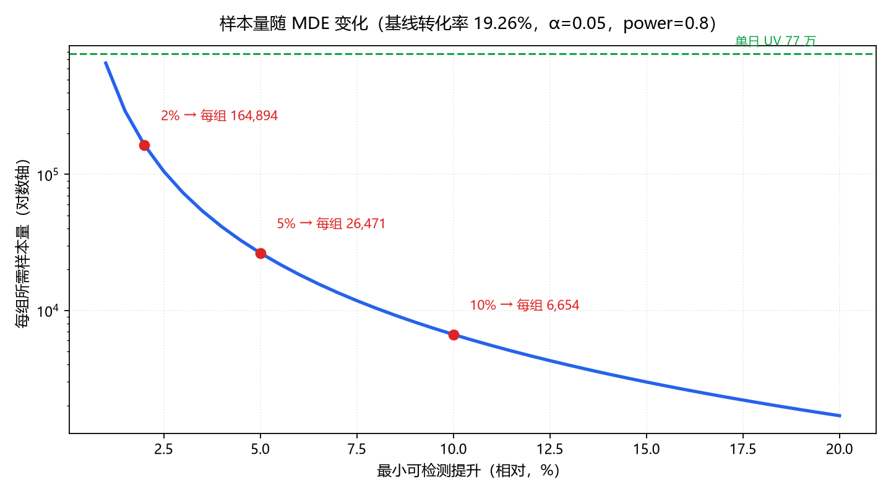
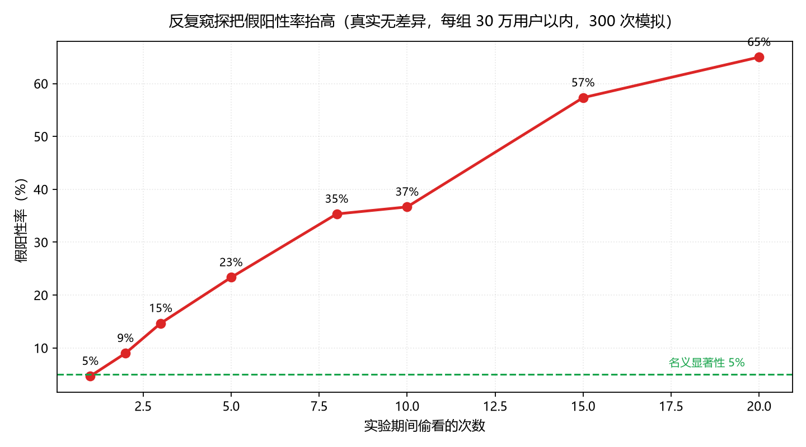

# 王梓安 · 数据分析作品集

求职意向：**数据分析师 / BI 工程师**　|　2026 届（沈阳化工大学 · 大数据管理与应用）

📮 3129626902@qq.com

---

## 这个仓库是什么

我在做数据分析时留下的完整过程记录：清洗、指标定义、分析脚本、图表和结论。

不是课件搬运，每个项目的数字都是我自己跑出来的，原始数据集不入库（体积太大 / 有版权），仓库里放的是**可跑通的样本数据**和**完整代码**。

## 项目索引

| # | 项目 | 数据规模 | 用什么做的 |
|---|---|---|---|
| 01 | [淘宝用户行为分析](./01-taobao-user-behavior) | 1.0 亿条原始日志 · 抽样 5.08%（503 万条）· 5 万用户 · 9 天 | Pandas / Matplotlib |
| 02 | [城市交通拥堵 GRU 预测](./02-traffic-congestion-gru) | 9 天 7776 条 · 24 维特征 · 3 区域 | PyTorch · GRU |
| 03 | [A/B 实验设计与分析框架](./03-ab-experiment) | 真实基线 19.26% · 日均 UV 77 万 · 模拟 140 万样本 | Python 标准库 / Matplotlib |
| 04 | [电商用户行为 MySQL 数据仓库](./04-mysql-data-warehouse) | **1.0015 亿行** · 四层分层 · SCD2 拉链表 | MySQL / 窗口函数 / CTE |

---

## 01 · 淘宝用户行为分析

把 1 亿条原始日志变成能支撑决策的东西：先定指标口径，再做漏斗找流失点，最后用 RFM 把人分层。

**关键数字**

- 总 PV 450 万次，总 UV 5 万人，人均 PV 90 次
- 日均 UV 38,777 人；工作日平均 PV 47.4 万，周末 53.3 万（**周末高 12.6%**）
- 行为分布高度倾斜：点击占 89.58%，收藏/加购/购买加起来才 10%
- 转化漏斗：点击 → 收藏 3.23%，缺口最大的一环就在这里
- 34,021 人有购买行为（有浏览行为的 49,800 人中占 68%）
- RFM 分层后 **流失用户 4,764 人，占 14.00%**

**踩过的坑**：日均 UV 不能拿"总 UV ÷ 天数"算，那样会把跨天重复的人算成新用户，必须先按天 groupby 求每日 UV 再取均值——两种算法出来的数差了 20%。

## 02 · 城市交通拥堵 GRU 预测

毕业论文的核心部分。用高德交通态势 API + Open-Meteo 天气 API 双源数据，对沈阳青年大街三个区做未来 1 小时拥堵预测。

**模型**：2 层 GRU（hidden 64）+ 全连接，参数量 45,176；24 维特征（时间周期编码 / 高峰标记 / 天气融合）；滑动窗口 36 步预测 12 步。

**结果（MAPE，越低越好）**

| 区域 | GRU | LSTM | ARIMA | 移动平均 |
|---|---|---|---|---|
| 核心区 | 4.59% | 5.17% | **3.78%** | 6.04% |
| 北区 | **2.29%** | 2.33% | 2.74% | 3.49% |
| 南区 | **3.16%** | 3.59% | 3.54% | 4.49% |

**结论要实话说**：北区和南区 GRU 最优，核心区被 ARIMA 反超（3.78% vs 4.59%）。原因是核心区序列规律性强，ARIMA 这类线性模型天然占优；而模式越复杂，GRU 的特征融合能力才体现出价值。

模型选择的本质是场景匹配，不是谁更先进。这个结论我写进了论文第 6 章的局限性里。

## 03 · A/B 实验设计与分析框架

大多数简历上的「熟悉 A/B 测试」只到"会跑两比例 z 检验"。这个项目把实验前、实验中、实验后三个环节都量化了。

基线来自我自己跑通的电商数仓：**9 天平均购买转化率 19.26%，日均 UV 77.4 万**。

**实验前 · 样本量**

| 想检测的相对提升 | 每组需要 | 按日均 UV 需 |
|---|---|---|
| 2% | 164,894 | 0.47 天 |
| 5% | 26,471 | 0.07 天 |
| 10% | 6,654 | 0.02 天 |

**实验中 · 三项必须验**

- 两比例 z 检验：z = 14.34、**p < 1e-10**、差值 95% CI **[0.83pp, 1.10pp]**
- SRM（样本比例失配）卡方校验：χ² = 0.00 → 分流正常
- 护栏指标（人均单量）Welch t 检验：p = 0.62 → 无恶化

**四项全过才叫可以放量。**

**实验后 · 两个反例会骗人**

1. **功效不足造成假阴性**：真实 +2% 提升，只跑 4 万样本（需要 16.5 万）→ p = 0.357，不显著。**不显著 ≠ 没效果。**
2. **反复窥探抬高假阳性**：真实无差异，看 10 次结果，假阳性从 5% 涨到 **37%**；看 20 次到 65%。要么只看一次，要么上 alpha spending。

> 诚实说明：真实数据里没有实验变量，**策略效应是模拟的**；基线转化率、样本规模、方差、检验方法与决策规则全部按真实口径走。这是"用真数据验证方法论"，不是伪造实验结果。

---

## 04 · 电商用户行为 MySQL 数据仓库

用 MySQL 单机把 **1.0015 亿行**原始日志搭成 ODS → DWD → DWS → ADS 四层数仓，含拉链表 SCD2、脏数据隔离和上下游对账。

**不是为了炫技术栈，是为了回答三个问题**：重复上报会不会把指标算两遍？时区切错会丢多少数据？出了问题是能不能说清少在哪？

**关键数字**

- 对账三层闭合：ODS 100,150,807 = DWD 100,095,182 + 脏数据 55,576 + 完全重复 49
- 四键去重（user_id / item_id / ts / behavior）实测只剔除 **49 行**，重复率 4.9e-7
- 时区修正救回 **118 万行**：ts 是 Unix 秒但业务按北京时间算天，切日必须 `timegm(day) - 8*3600`
- 按 3 小时分批去重，避开单次大排序打穿 buffer pool（全程 56 分钟）

**两份文档才是重点**

- [`METRICS.md`](./04-mysql-data-warehouse/METRICS.md)：每个指标的定义与口径边界，外加**这份数据算不了的 8 个指标**（GMV / 客单价 / 退款率 / ROI…）
- [`DQ_REPORT.md`](./04-mysql-data-warehouse/DQ_REPORT.md)：质量校验报告，P0/P1/P2 分级 + 对账明细 + 可复现命令

**一次真实排障**：按天整块跑 `ROW_NUMBER` 去重时 MySQL 直接崩了，日志刷 `Difficult to find free blocks in the buffer pool`——buffer pool 默认 128M 撑不住 5.7 GB 表 + 1100 万行排序。改成 6G + 分批之后跑通。

> 面试被问「为什么没有 GMV」，答案是「数据没有价格字段，所以我用订单数和转化率」——比硬编一个数字安全一万倍。

---

## 技能

**数据处理** Python（Pandas / NumPy）、SQL（多表连接、窗口函数、CTE）、MySQL 分层建仓（ODS/DWD/DWS/ADS、拉链表 SCD2）
**建模分析** 时间序列预测（GRU / LSTM / ARIMA）、RFM 分层、漏斗与留存分析、**A/B 实验（样本量与功效、两比例 z 检验、Welch t 检验、SRM 校验、序贯窥探风险）**、信效度检验（Cronbach's α、KMO）
**可视化** Matplotlib、Tableau、Power BI、PPT
**其他** Hadoop 平台基础操作、Coze 工作流搭建

## 其他经历

- **沈阳后浪科技传媒**（2023.09–2024.01）数据运营：搭建 UV / 互动率 / 转化率指标体系，多渠道裂变带来私域引流 2000+
- **挑战杯**（2023）校级三等奖：基于 ACSI 模型做消费者满意度研究，回收有效问卷 350 份，Cronbach's α = 0.965，KMO = 0.95
- **辽宁省数字营销创新大赛**（2024）省级二等奖

---

## 说明

- 原始淘宝 UserBehavior 数据集约 3.5 GB，仓库只保留 2 万行样本（1.5 MB）用于跑通代码；
- 交通项目数据为 2026 年 5 月 10–20 日采集的公开路况指数与天气数据；
- 所有指标口径、清洗规则都写在对应 notebook 里，欢迎提 issue 指正。
